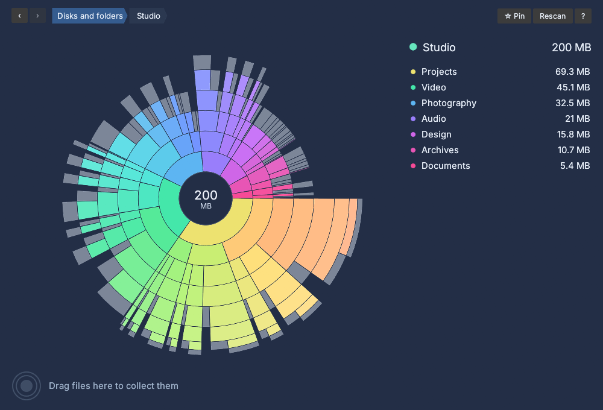

# Corolla



Corolla is a native Rust disk explorer for Omarchy, modeled on DaisyDisk. Scan a disk or drop a folder into the window. Each ring shows another level of the directory tree. Wider segments take up more space. Hover to inspect a branch, click to zoom in, and click the center to go up one level.

## Run on Omarchy

Open **Corolla** from the launcher, run `corolla` for the disks overview, or pass a directory to scan immediately.

```sh
corolla ~/Downloads
```

To build and install for your user, run `bin/install` with a stable Rust toolchain installed. It installs the executable, icon and launcher entry. The window uses native Wayland on Hyprland. The folder picker uses the desktop portal.

For a pacman-managed installation, `bin/package` creates an Arch package in `packaging/`. Install that file with `sudo pacman -U`. Use `cargo test --release --locked` to run the tests.

Corolla keeps completed scans so you can reopen disks, folders, and their scanned subfolders, even after quitting. The map shows the last scan. Press **R** or click **Rescan** to pick up changes made elsewhere. You can cancel a rescan and keep exploring the previous map. Refreshing a subfolder updates its branch in cached parent maps. Recent maps are saved privately in `$XDG_CACHE_HOME/corolla/scans` (normally `~/.cache/corolla/scans`). The disk cache holds up to 12 maps within 512 MiB. Very large maps that exceed the snapshot limits remain available in memory during the session. The command-line JSON report always scans the filesystem.

## Explore and clean up

Gray petals represent files. Colored petals represent folders. Very small neighbors share a dimmed segment that opens a list. On a whole disk, purple shows used space outside the scan and the gap shows free space. The inspector ranks items by allocated size. Sparse files use their allocated blocks, and hard links share one allocation. Btrfs reflinks and snapshots can share physical extents, so removing an item may release less space than its displayed size.

Drag a petal or inspector row to the collector. While you hold a folder, its branch follows the pointer and the map closes the gap. A red slash on the collector explains why an item cannot be added. Release outside the collector or press **Esc** to cancel the drag. Open the collector to review or remove items, move them to the desktop Trash, or permanently delete them after confirmation. Empty the desktop Trash to reclaim space from trashed files. Cleanup runs with your normal user permissions.

| Shortcut | Action |
| --- | --- |
| Ctrl+O / Ctrl+L | Choose a folder / enter its path |
| Ctrl+D | Pin or unpin the current folder in the overview |
| ↑ / ↓ | Select an item |
| Enter / → | Open the selection |
| Space | Preview the item, or scan the first disk from the overview |
| ← / Esc | Go to the parent, dismiss a dialog, or cancel a scan |
| Alt+← / Alt+→ | Go back / forward |
| Delete / C | Collect the highlighted item / review the collector |
| R | Rescan or refresh the volume list |
| ? / Q | Show shortcuts / quit |

For a disk-usage report without opening a window, run `corolla scan --json DIRECTORY`. It prints the same allocated-byte totals used by the map, immediate children in size order, and the count of unreadable entries.

## File history (proof of concept)

Run a watcher to record changes made by any application under a directory you choose. The GUI can be closed. The first run commits a baseline to a local DoltLite database. Following commits record changes to paths, file types, logical and allocated sizes, timestamps and Unix metadata. File contents are never copied, so these revisions cannot restore a deleted file.

Install the `doltlite` executable on your PATH and build this branch with `bin/install`. Only file history requires DoltLite. This POC has been tested with [DoltLite v0.51.14](https://github.com/dolthub/doltlite/releases/tag/v0.51.14).

```sh
# Terminal 1
corolla history watch "$HOME/Documents"

# Terminal 2, after the watcher reports ready
corolla history log
corolla history log "$HOME/Documents/notes.txt"
```

The log shows the latest 100 matching path changes, including deleted paths. Relative paths are resolved from the watched directory. In the explorer, right-click an inspector row and choose **History…**. Folder history includes changes to descendants.

The watcher uses Linux inotify. It stays on the selected mount, records symlinks as entries and groups nearby events into one commit. A rename can appear as a removal and an addition. Rapid edits can collapse into one revision, and a file created and deleted between observations can go unseen. A restart reconciles the last committed state with what is on disk. Edits that happened entirely while the watcher was stopped cannot be reconstructed.

Corolla keeps one watched root per database. The default is `$XDG_STATE_HOME/corolla/history/files.dolt`, normally `~/.local/state/corolla/history/files.dolt`. To use another database, set `COROLLA_HISTORY_DB` for both the watcher and the GUI or log command. The database grows with recorded changes. It is separate from the radial map's scan cache. You can inspect the commits directly with DoltLite.

```sh
db=${COROLLA_HISTORY_DB:-${XDG_STATE_HOME:-$HOME/.local/state}/corolla/history/files.dolt}
doltlite -readonly "$db" 'SELECT commit_hash, date, message FROM dolt_log LIMIT 10'
```

### Run the watcher at login

Both installers include a systemd user service. Select an existing directory and use its escaped path as the instance name. Stop a foreground watcher on the same database first.

```sh
unit=$(systemd-escape --path --template=corolla-history@.service "$HOME/Documents")
systemctl --user daemon-reload
systemctl --user enable --now "$unit"
journalctl --user -u "$unit" -n 20
# To stop recording and disable startup
systemctl --user disable --now "$unit"
```

The service looks for `corolla` and `doltlite` in `~/.local/bin`, `/usr/local/bin` and `/usr/bin`. To exercise the watcher, an external writer and DoltLite together on a temporary directory, run `cargo test --locked --test history -- --ignored`.

## License

Corolla is distributed under the [MIT License](LICENSE). The bundled Inter font is distributed under the [SIL Open Font License 1.1](assets/Inter-LICENSE.txt).
